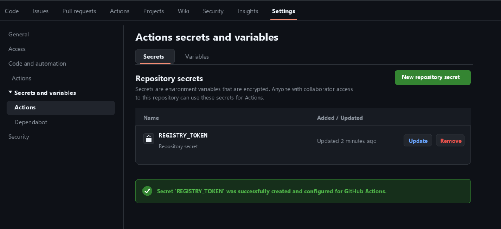

## 1. Mục tiêu
- Tạo tệp mã hóa an toàn (**Repository Secret**) lưu trữ Token cá nhân trên GitHub.
- Cấu hình bước xác thực đăng nhập tự động vào GitHub Container Registry (**GHCR**) qua action `docker/login-action@v3`.

---

## 2. Các bước thực hiện

### Bước 1: Khởi tạo Personal Access Token (PAT)
1. Trên GitHub: Vào **Settings** (User profile) -> **Developer settings** -> **Personal access tokens** -> **Tokens (classic)**.
2. Nhấn **Generate new token (classic)**.
3. Chọn các quyền tối thiểu cần thiết:
   - `write:packages`: Tải lên và quản lý container image trên GitHub Packages.
   - `read:packages`: Kéo container image từ GitHub Packages.
4. Copy mã token vừa sinh.

### Bước 2: Cấu hình Repository Secret
1. Điều hướng tới kho lưu trữ GitHub: **Settings** -> **Secrets and variables** -> **Actions**.
2. Nhấn **New repository secret**.
3. Điền thông tin:
   - **Name**: `REGISTRY_TOKEN`
   - **Secret**: Dán PAT vừa tạo ở Bước 1.
4. Nhấn **Add secret**.

### Bước 3: Khai báo trong tệp kịch bản `.github/workflows/ci.yml`
```yaml
      - name: Đăng nhập vào GitHub Container Registry
        uses: docker/login-action@v3
        with:
          registry: ghcr.io
          username: ${{ github.actor }}
          password: ${{ secrets.REGISTRY_TOKEN }}
```

---

## 3. Ảnh chụp minh chứng mục Repository Secrets



---

## 4. Kết quả kiểm tra Log trên GitHub Actions

Sau khi đẩy code lên nhánh `main`, mở chi tiết bước **Đăng nhập vào GitHub Container Registry**:

```text
Run docker/login-action@v3
  with:
    registry: ghcr.io
    username: hoangminhquang
    password: ***
    logout: true
Logging into ghcr.io...
Login Succeeded!
```
- **Xác nhận**: Bước đăng nhập hoàn tất với thông báo `Login Succeeded!`, biến bí mật `secrets.REGISTRY_TOKEN` được bảo mật tự động (hiển thị `***`).